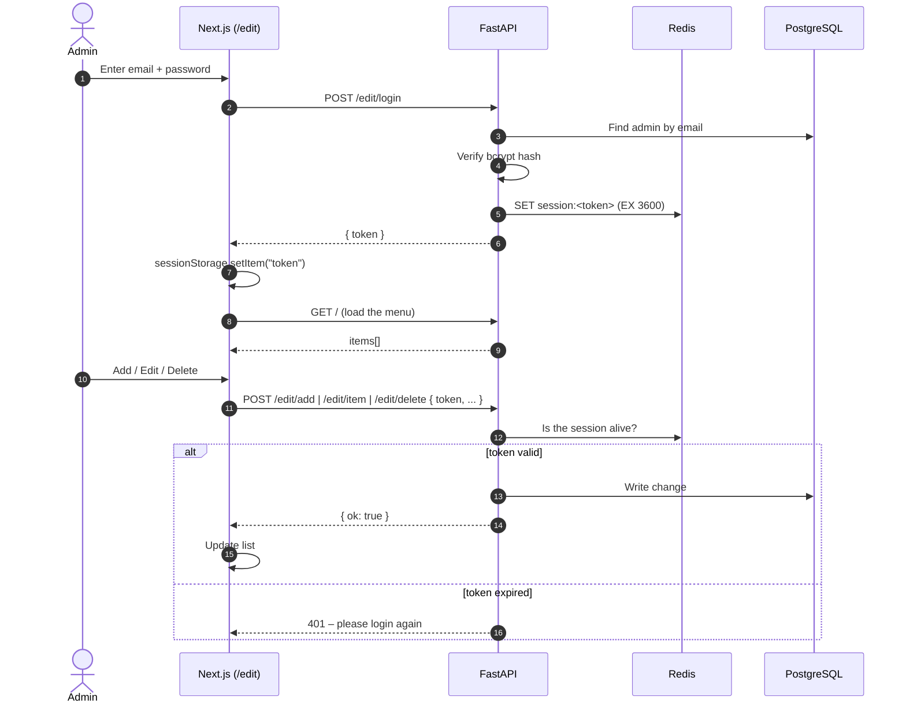

<div align="center">


<a href="https://git.io/typing-svg">
  
</a>

<br/>

[](https://menu-backend-fagr.vercel.app/)
[](https://menu-backend-fagr.vercel.app/edit)
[](https://github.com/Omar404X0/Menu-Backend)


<br/><br/>


</div>


## 📖 Table of Contents

- [✨ Overview](#-overview)
- [🌐 Live Demo](#-live-demo)
- [📸 Screenshots](#-screenshots)
- [🎯 Features](#-features)
- [🏗️ Architecture](#️-architecture)
- [🔄 Admin Flow](#-admin-flow)
- [🧩 Component Breakdown](#-component-breakdown)
- [🎨 Design System](#-design-system)
- [🛠️ Tech Stack](#️-tech-stack)
- [🚀 Getting Started](#-getting-started)
- [🔧 Environment Variables](#-environment-variables)
- [☁️ Deployment](#️-deployment)
- [🧠 What I Learned](#-what-i-learned)
- [🗺️ Roadmap](#️-roadmap)
- [🔗 Related Repository](#-related-repository)


## ✨ Overview

**Layali** is a café menu that feels alive. Instead of a boring price list, customers get a hand-crafted scrolling experience: **floating coffee beans**, a **whipped-cream cloud** that melts into the iced section, and a **chocolate drip** that pours into the cakes section, with stacked **looping video cards** beside every category.

Behind the scenes, the café owner gets a private **glassmorphism admin dashboard** to add, edit and delete products in real time, with no code and no redeploy. Every change goes through a secured API and shows up on the public menu instantly.

> The public menu and the admin panel are two parts of **one** Next.js app, and both talk to the same FastAPI backend.


## 🌐 Live Demo

| Page | URL |
|------|-----|
| ☕ Public menu | https://menu-backend-fagr.vercel.app/ |
| 🔐 Admin dashboard | https://menu-backend-fagr.vercel.app/edit |
| ⚙️ API (Render) | https://menu-backend-grr7.onrender.com |

> ⏳ The API runs on a free Render instance. If it has been idle, the **first request can take ~30–50 seconds** while the server wakes up.


## 📸 Screenshots

### Public menu

<table>
  <tr>
    <td align="center" width="100%">
      
      <br/><sub><b>Hot Favorites</b>: falling coffee beans, dotted price leaders and stacked video cards</sub>
    </td>
  </tr>
  <tr>
    <td align="center">
      
      <br/><sub><b>Iced Favorites</b>: whipped-cream clouds with a soft pink and matcha palette</sub>
    </td>
  </tr>
  <tr>
    <td align="center">
      
      <br/><sub><b>Cakes</b>: a chocolate drip pouring over the page</sub>
    </td>
  </tr>
</table>

### Admin dashboard

<table>
  <tr>
    <td align="center" width="50%">
      
      <br/><sub><b>Login</b>: frosted-glass card over animated gradient orbs</sub>
    </td>
    <td align="center" width="50%">
      
      <br/><sub><b>New product</b>: category chips + inline “+ New” category</sub>
    </td>
  </tr>
  <tr>
    <td align="center" colspan="2">
      
      <br/><sub><b>Dashboard</b>: items grouped by category with edit and delete actions</sub>
    </td>
  </tr>
</table>


## 🎯 Features

### 🍽️ Public menu
- **Dynamic content**: items are fetched from the API, so nothing is hard-coded.
- **Category sections** (`hot`, `cold`, `cake`) with dotted “leader” lines between name and price.
- **Stacked video cards** with autoplay, loop, muted and `playsInline`. Hovering a card straightens it, scales it up and brings it to the front.
- **Custom scenery per section**: `CoffeeBeans`, `IcedFoam` (clouds) and `ChocolateDrip`.
- **Per-section colour themes** (cream → pink → cream) for a clear visual rhythm.
- **Fully responsive**, with a column layout on mobile and a split layout on desktop.

### 🔐 Admin dashboard (`/edit`)
- **Email + password login** against the backend, with show/hide password toggle and a shake animation on errors.
- **Session token** stored in `sessionStorage`, so it dies when the tab closes (the server also expires it after 1 hour).
- **Full CRUD**:
  - ➕ Add a product, choosing an existing category or creating a new one on the fly
  - ✏️ Edit name, price and category in a modal (with a `datalist` of categories)
  - 🗑️ Delete a product instantly
- **Optimistic UI**: edits and deletes update the screen immediately.
- **Keyboard friendly**: `Enter` moves or submits, `Esc` closes modals.
- **Input validation** (empty fields, NaN and negative prices) before anything is sent.
- **Glassmorphism UI** with blurred orbs, gradient borders and smooth micro-interactions.


## 🏗️ Architecture


## 🔄 Admin Flow




## 🧩 Component Breakdown

```text
app/
├── page.tsx              # Public menu (Home)
├── edit/
│   └── page.tsx          # Admin dashboard (login + CRUD)
├── CoffeeBeans.tsx       # Floating beans scenery (hot section)
├── MatchaPowder.tsx      # `IcedFoam`: whipped cream clouds (iced section)
├── ChocolateDrip.tsx     # Dripping chocolate (cakes section)
public/
├── coffee.mp4  Tea.mp4  latte.mp4
├── iced.mp4    iced2.mp4  iced3.mp4
└── cake.mp4    cake2.mp4  cake3.mp4
```

| Component | Responsibility |
|-----------|----------------|
| `Home` | Fetches items once, filters per category with `by(category)` and renders three themed sections |
| `MenuSection` | Layout of one section: title + list on one side, video stack on the other |
| `MenuList` | Renders `name ····· price` rows with dotted leaders |
| `VideoStack` | Three absolutely-positioned, rotated video cards (`POS` array) with hover effects |
| `AdminLogin` | One component with 3 states: login, dashboard, and modals (edit/add) |


## 🎨 Design System

| Token | Colour | Used for |
|-------|--------|----------|
| 🟫 Espresso | `#2a1a12` | Admin background |
| 🌸 Orchid | `#dfc1d3` | Primary accent, buttons, focus rings |
| 🍑 Peach | `#f3d9c8` | Prices, gradient highlights |
| 🌿 Matcha | `#9dbb6b` / `#577665` | Iced section & ambient orb |
| 🥛 Cream | `#e0dcd1` | Public menu background |
| 🍫 Cocoa | `#3b2216` | Text on light buttons |

Typography uses a handwritten script for the public menu and **Poppins** for the admin UI.


## 🛠️ Tech Stack

| Layer | Tech |
|-------|------|
| Framework | **Next.js** (App Router, client components) |
| Language | **TypeScript** |
| Styling | **Tailwind CSS** |
| State | React hooks (`useState`, `useRef`, `useEffect`) |
| Hosting | **Vercel** |
| API | FastAPI on **Render** |


## 🚀 Getting Started

```bash
# 1. Clone
git clone https://github.com/Omar404X0/Menu-Frontend.git
cd Menu-Frontend

# 2. Install
npm install

# 3. Configure
cp .env.example .env.local     # then edit the API URL

# 4. Run
npm run dev
```

Open **http://localhost:3000** for the menu and **http://localhost:3000/edit** for the admin panel.

Make sure the backend is running locally (default `http://localhost:8000`). See the backend repo for setup.


## 🔧 Environment Variables

| Variable | Description | Default |
|----------|-------------|---------|
| `NEXT_PUBLIC_API_URL` | Base URL of the FastAPI backend | `https://menu-backend-grr7.onrender.com` |

`.env.local` example:

```env
NEXT_PUBLIC_API_URL=http://localhost:8000
```


## ☁️ Deployment

1. Push the repo to GitHub.
2. Import it on **[Vercel](https://vercel.com)**.
3. Add `NEXT_PUBLIC_API_URL` under *Project → Settings → Environment Variables*.
4. Deploy. Every push to `main` redeploys automatically.
5. Add your Vercel domain to the backend's `FRONTEND_URL` so **CORS** allows it.


## 🧠 What I Learned

This project was my hands-on playground for turning new tools into one real, deployed product:

- 🔴 **Redis**: server-side sessions with automatic expiry
- 🐳 **Docker**: containerising the backend for consistent environments
- 🧪 **pytest**: testing the API endpoints
- 🌩️ **Cloud deployment**: Vercel (frontend), Render (API), Neon (PostgreSQL)
- 🎨 **Frontend craft**: glassmorphism, animation and responsive layouts


## 🗺️ Roadmap

- [ ] Move the token to an `Authorization: Bearer` header
- [ ] Replace `alert()` with toast notifications
- [ ] Image upload for products
- [ ] Arabic / RTL language toggle
- [ ] Drag-and-drop ordering of items
- [ ] Dark/light menu mode


## 🔗 Related Repository

| Repo | Description |
|------|-------------|
| **[Backend](https://github.com/Omar404X0/Menu-Backend)** (`Menu-Backend`) | FastAPI + SQLAlchemy + Redis + Docker + pytest |


<div align="center">

Made with ☕ and 💜 by **[Omar Elmallah](https://github.com/Omar404X0)**


</div>
