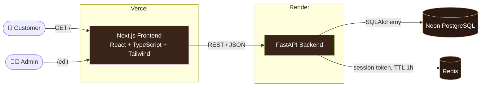
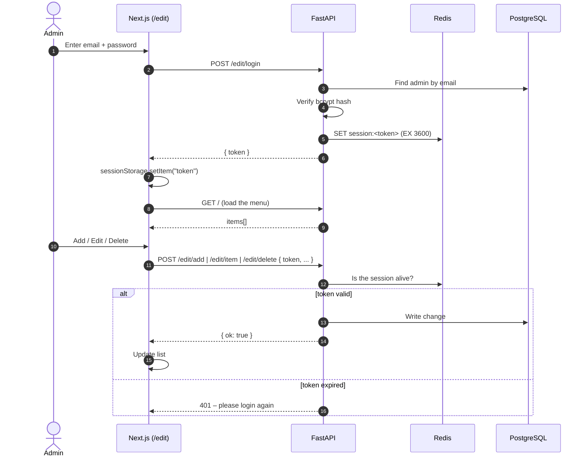

<div align="center">


<a href="https://git.io/typing-svg">
  
</a>

<br/>

<a href="https://menu-backend-fagr.vercel.app/"></a>
<a href="https://menu-backend-fagr.vercel.app/edit"></a>
<a href="https://github.com/Omar404X0/Menu-Backend"></a>

<br/><br/>


<br/><br/>


</div>


<table align="center">
  <tr>
    <td align="center" width="25%"><h1>3</h1><sub><b>MENU CATEGORIES</b><br/>hot · cold · cake</sub></td>
    <td align="center" width="25%"><h1>9</h1><sub><b>LOOPING VIDEO CARDS</b><br/>3 per section</sub></td>
    <td align="center" width="25%"><h1>3</h1><sub><b>ANIMATED SCENES</b><br/>beans · clouds · drips</sub></td>
    <td align="center" width="25%"><h1>1h</h1><sub><b>SECURE SESSION</b><br/>Redis-backed token</sub></td>
  </tr>
</table>


## 📖 Table of Contents

<table>
  <tr>
    <td>

- [✨ Overview](#-overview)
- [🌐 Live Demo](#-live-demo)
- [🎯 Features](#-features)
- [🏗️ Architecture](#️-architecture)
- [🔄 Admin Flow](#-admin-flow)

</td>
    <td>

- [🧩 Component Breakdown](#-component-breakdown)
- [🎨 Design System](#-design-system)
- [🚀 Getting Started](#-getting-started)
- [☁️ Deployment](#️-deployment)
- [🗺️ Roadmap](#️-roadmap)

</td>
  </tr>
</table>


## ✨ Overview

**Layali** is a café menu that feels alive. Instead of a boring price list, customers get a hand-crafted scrolling experience: **floating coffee beans**, a **whipped-cream cloud** that melts into the iced section, and a **chocolate drip** that pours into the cakes section, with stacked **looping video cards** beside every category.

Behind the scenes, the café owner gets a private **glassmorphism admin dashboard** to add, edit and delete products in real time, with no code and no redeploy.

> [!NOTE]
> The public menu and the admin panel are two parts of **one** Next.js app, and both talk to the same FastAPI backend.


## 🌐 Live Demo

<table>
  <tr>
    <td align="center" width="50%">
      <h3>☕ Public Menu</h3>
      <a href="https://menu-backend-fagr.vercel.app/">menu-backend-fagr.vercel.app</a>
      <br/><sub>What your customers see</sub>
    </td>
    <td align="center" width="50%">
      <h3>🔐 Admin Dashboard</h3>
      <a href="https://menu-backend-fagr.vercel.app/edit">menu-backend-fagr.vercel.app/edit</a>
      <br/><sub>Where the owner manages products</sub>
    </td>
  </tr>
</table>

> [!TIP]
> The API runs on a free Render instance. If it has been idle, the **first request can take ~30–50 seconds** while the server wakes up. After that it's instant.


## 🎯 Features

<table>
  <tr>
    <td width="50%" valign="top">
      <h3>🍽️ Dynamic Menu</h3>
      Items come straight from the API, grouped by category, with dotted “leader” lines between name and price. Nothing is hard-coded.
    </td>
    <td width="50%" valign="top">
      <h3>🎞️ Stacked Video Cards</h3>
      Autoplay, loop and muted clips in tilted cards. Hover straightens a card, scales it up and brings it to the front.
    </td>
  </tr>
  <tr>
    <td width="50%" valign="top">
      <h3>🎨 Scenery Per Section</h3>
      <code>CoffeeBeans</code>, whipped-cream <code>IcedFoam</code> and a dripping <code>ChocolateDrip</code>, each with its own colour theme.
    </td>
    <td width="50%" valign="top">
      <h3>📱 Fully Responsive</h3>
      A single-column layout on phones and a split layout on desktop, tuned with Tailwind breakpoints.
    </td>
  </tr>
  <tr>
    <td width="50%" valign="top">
      <h3>🔐 Secure Admin Login</h3>
      Email + password against the backend. The session token lives in <code>sessionStorage</code> and expires server-side after one hour.
    </td>
    <td width="50%" valign="top">
      <h3>✏️ Full CRUD</h3>
      Add a product (pick or create a category on the fly), edit name, price and category in a modal, or delete it instantly.
    </td>
  </tr>
  <tr>
    <td width="50%" valign="top">
      <h3>⚡ Optimistic UI</h3>
      Edits and deletes update the screen immediately, then sync with the server.
    </td>
    <td width="50%" valign="top">
      <h3>⌨️ Keyboard Friendly</h3>
      <code>Enter</code> moves or submits, <code>Esc</code> closes modals, and every field is validated before anything is sent.
    </td>
  </tr>
</table>


## 🏗️ Architecture




## 🔄 Admin Flow




## 🧩 Component Breakdown

```text
app/
├── page.tsx              # Public menu (Home)
├── edit/
│   └── page.tsx          # Admin dashboard (login + CRUD)
├── CoffeeBeans.tsx       # Floating beans scenery (hot section)
├── MatchaPowder.tsx      # `IcedFoam`: whipped cream clouds (iced section)
├── ChocolateDrip.tsx     # Dripping chocolate (cakes section)
public/
├── coffee.mp4  Tea.mp4  latte.mp4
├── iced.mp4    iced2.mp4  iced3.mp4
└── cake.mp4    cake2.mp4  cake3.mp4
```

<details>
<summary><b>🔎 What each component does</b></summary>

<br/>

| Component | Responsibility |
|-----------|----------------|
| `Home` | Fetches items once, filters per category with `by(category)` and renders three themed sections |
| `MenuSection` | Layout of one section: title + list on one side, video stack on the other |
| `MenuList` | Renders `name ····· price` rows with dotted leaders |
| `VideoStack` | Three absolutely-positioned, rotated video cards (`POS` array) with hover effects |
| `AdminLogin` | One component with 3 states: login, dashboard, and modals (edit/add) |

</details>


## 🎨 Design System

<table>
  <tr>
    <td align="center"><br/><b>Espresso</b><br/><code>#2a1a12</code><br/><sub>Admin background</sub></td>
    <td align="center"><br/><b>Orchid</b><br/><code>#dfc1d3</code><br/><sub>Accent & focus rings</sub></td>
    <td align="center"><br/><b>Peach</b><br/><code>#f3d9c8</code><br/><sub>Prices & highlights</sub></td>
    <td align="center"><br/><b>Matcha</b><br/><code>#9dbb6b</code><br/><sub>Iced section orb</sub></td>
    <td align="center"><br/><b>Cream</b><br/><code>#e0dcd1</code><br/><sub>Menu background</sub></td>
  </tr>
</table>

Typography uses a handwritten script for the public menu and **Poppins** for the admin UI.


## 🚀 Getting Started

```bash
# 1. Clone
git clone https://github.com/Omar404X0/Menu-Frontend.git
cd Menu-Frontend

# 2. Install
npm install

# 3. Configure
cp .env.example .env.local     # then edit the API URL

# 4. Run
npm run dev
```

Open **http://localhost:3000** for the menu and **http://localhost:3000/edit** for the admin panel.

| Variable | Description | Default |
|----------|-------------|---------|
| `NEXT_PUBLIC_API_URL` | Base URL of the FastAPI backend | `https://menu-backend-grr7.onrender.com` |

```env
# .env.local
NEXT_PUBLIC_API_URL=http://localhost:8000
```

> [!IMPORTANT]
> Run the backend locally first (default `http://localhost:8000`). See the [Menu-Backend](https://github.com/Omar404X0/Menu-Backend) repo for setup.


## ☁️ Deployment

<table>
  <tr>
    <td align="center" width="25%"><h3>1️⃣</h3><b>Push</b><br/><sub>Push the repo to GitHub</sub></td>
    <td align="center" width="25%"><h3>2️⃣</h3><b>Import</b><br/><sub>Import it on <a href="https://vercel.com">Vercel</a></sub></td>
    <td align="center" width="25%"><h3>3️⃣</h3><b>Configure</b><br/><sub>Add <code>NEXT_PUBLIC_API_URL</code> in Environment Variables</sub></td>
    <td align="center" width="25%"><h3>4️⃣</h3><b>Ship</b><br/><sub>Every push to <code>master</code> redeploys automatically</sub></td>
  </tr>
</table>

> [!WARNING]
> Add your Vercel domain to the backend's `FRONTEND_URL`, otherwise **CORS** will block the requests.


## 🧠 What I Learned

This project was my hands-on playground for turning new tools into one real, deployed product:

| | Tool | What I practised |
|---|------|------------------|
| 🔴 | **Redis** | Server-side sessions with automatic expiry |
| 🐳 | **Docker** | Containerising for consistent environments |
| 🧪 | **pytest** | Testing the API endpoints |
| 🌩️ | **Cloud** | Vercel (frontend) · Render (API) · Neon (PostgreSQL) |
| 🎨 | **Frontend craft** | Glassmorphism, animation and responsive layouts |


## 🗺️ Roadmap

- [x] Public animated menu
- [x] Admin login with Redis sessions
- [x] Add / edit / delete products
- [ ] Send the token via an `Authorization: Bearer` header
- [ ] Toast notifications instead of `alert()`
- [ ] Image upload for products
- [ ] Arabic / RTL language toggle
- [ ] Drag-and-drop ordering of items


<div align="center">

### Enjoyed it? Drop a ⭐ and check the [backend repo](https://github.com/Omar404X0/Menu-Backend)

Made with ☕ and 💜 by **[Omar Elmallah](https://github.com/Omar404X0)**


</div>
